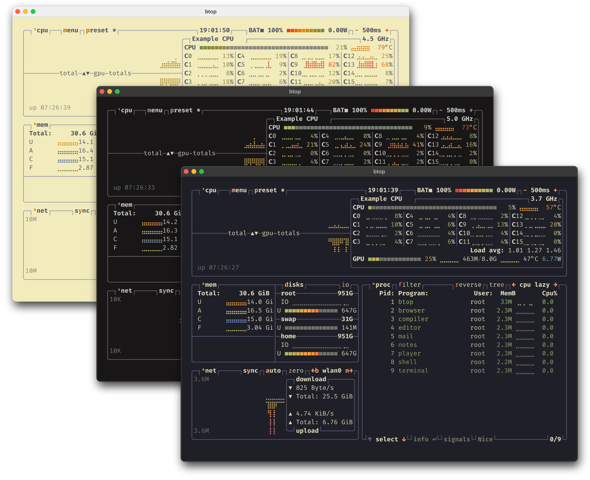
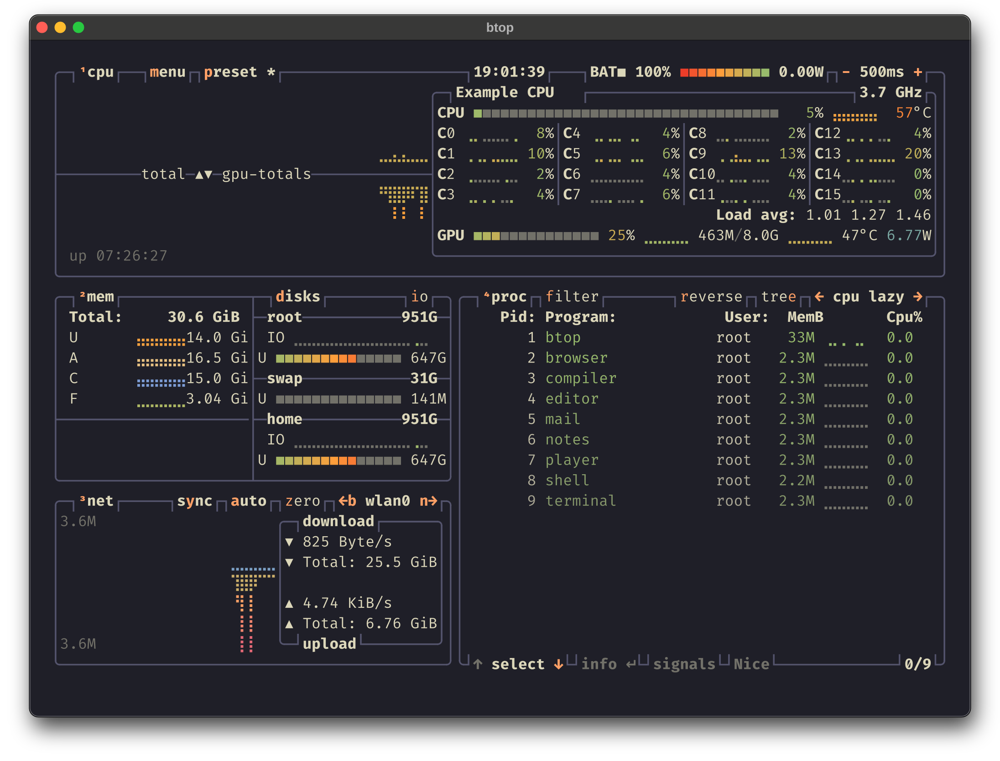
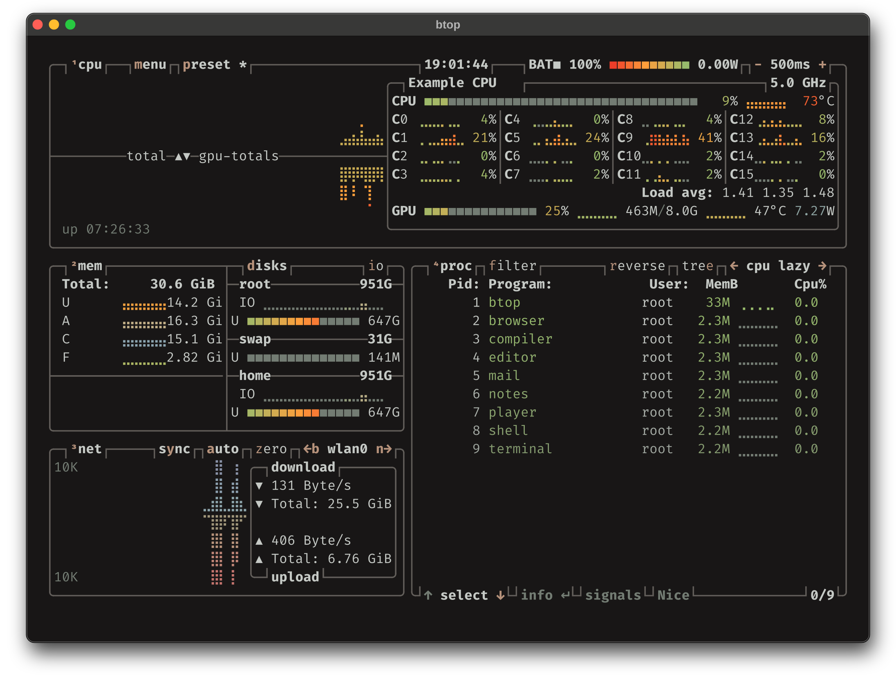
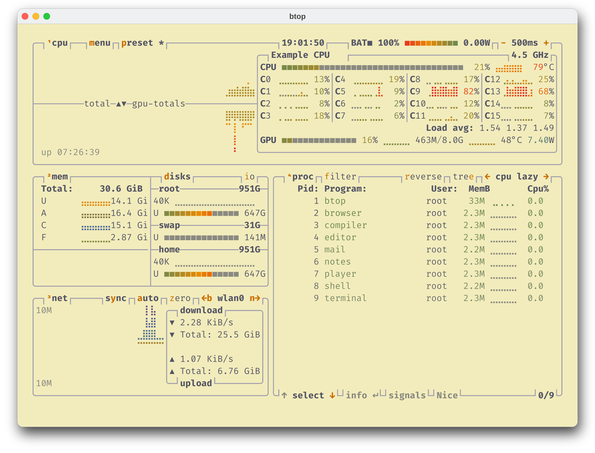

<h3>Kanagawa for <a href="https://github.com/aristocratos/btop">btop</a></h3>
<p>A community-maintained theme inspired by Hokusai's <em>The Great Wave off Kanagawa</em>.</p>
<p>Using the <a href="https://github.com/rebelot/kanagawa.nvim">Kanagawa palette</a> by <a href="https://github.com/rebelot">Tommaso Laurenzi (rebelot)</a>.</p>

<!-- Wave accents: carpYellow, crystalBlue, autumnRed. Lotus accents: lotusYellow, lotusBlue4, lotusRed. -->
<p>
  <a href="https://github.com/kanagawa-community/btop/stargazers">
    <picture>
      <source media="(prefers-color-scheme: dark)" srcset="https://img.shields.io/github/stars/kanagawa-community/btop?style=for-the-badge&amp;labelColor=1F1F28&amp;color=E6C384">
      <source media="(prefers-color-scheme: light)" srcset="https://img.shields.io/github/stars/kanagawa-community/btop?style=for-the-badge&amp;labelColor=F2ECBC&amp;color=77713F">
      
    </picture>
  </a>
  <a href="https://github.com/kanagawa-community/btop/releases/latest">
    <picture>
      <source media="(prefers-color-scheme: dark)" srcset="https://img.shields.io/github/v/release/kanagawa-community/btop?style=for-the-badge&amp;label=release&amp;labelColor=1F1F28&amp;color=7E9CD8">
      <source media="(prefers-color-scheme: light)" srcset="https://img.shields.io/github/v/release/kanagawa-community/btop?style=for-the-badge&amp;label=release&amp;labelColor=F2ECBC&amp;color=4D699B">
      
    </picture>
  </a>
  <a href="https://github.com/kanagawa-community/btop/issues">
    <picture>
      <source media="(prefers-color-scheme: dark)" srcset="https://img.shields.io/github/issues/kanagawa-community/btop?style=for-the-badge&amp;labelColor=1F1F28&amp;color=C34043">
      <source media="(prefers-color-scheme: light)" srcset="https://img.shields.io/github/issues/kanagawa-community/btop?style=for-the-badge&amp;labelColor=F2ECBC&amp;color=C84053">
      
    </picture>
  </a>
</p>

<br clear="both">
<br>

## Previews



<details>
<summary>🌊 Wave</summary>

</details>

<details>
<summary>🐉 Dragon</summary>

</details>

<details>
<summary>🪷 Lotus</summary>

</details>

## Requirements

- btop 1.2 or later, with a terminal that supports truecolor.

## Installation

Download the three themes into btop's theme folder:

```sh
mkdir -p ~/.config/btop/themes
for variant in wave dragon lotus; do
  curl -fsSL -o ~/.config/btop/themes/kanagawa-$variant.theme https://raw.githubusercontent.com/kanagawa-community/btop/main/themes/kanagawa-$variant.theme
done
```

You can also clone the repository and copy everything in `themes/`.

## Usage

In btop, press `Esc`, open **Options**, and choose `kanagawa-wave`, `kanagawa-dragon` or `kanagawa-lotus` as the color theme. Or set it in `~/.config/btop/btop.conf`:

```ini
color_theme = "kanagawa-wave"
```

On a transparent terminal, set `theme_background = False` in `btop.conf`.

## Palette

Every color comes from the shared
[palette](https://github.com/kanagawa-community/.github/blob/main/docs/PALETTE.md),
picked by role, so each variant uses its own value for the same role.

| btop color                              | Palette role                                   |
| --------------------------------------- | ---------------------------------------------- |
| `main_bg`                               | `ui.bg`                                        |
| `main_fg`, `title`, `selected_fg`       | `ui.fg`                                        |
| `hi_fg`                                 | `syn.constant`                                 |
| `selected_bg`                           | `ui.bg_visual`                                 |
| `inactive_fg`                           | `syn.comment`                                  |
| `proc_misc`                             | `syn.special1`                                 |
| `*_box`, `div_line`                     | `ui.nontext`                                   |
| `temp`, `cpu`, `free`, `used` gradients | `diag.ok`, `diag.warning`, `diag.error`        |
| `cached`, `download` gradients          | `syn.type`, `syn.fun`, `syn.keyword`           |
| `available` gradient                    | `syn.string`, `syn.identifier`, `syn.constant` |
| `upload` gradient                       | `syn.string`, `syn.constant`, `syn.preproc`    |

## Issues and contributions

Report bugs and request changes in this port's
[issue tracker](https://github.com/kanagawa-community/btop/issues). Contributions are welcome.

See [CONTRIBUTING.md](CONTRIBUTING.md) before opening a pull request.

## License

MIT. See [LICENSE](LICENSE).
